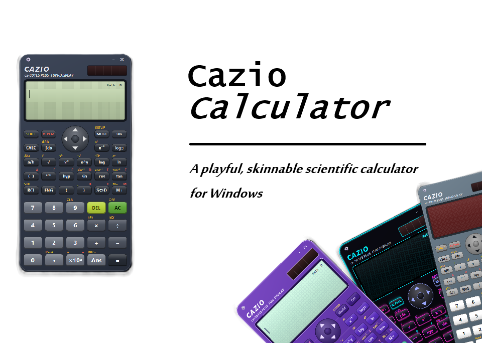

# Cazio

A playful, skinnable scientific calculator for Windows, modelled on the classic **Casio fx-991** series. Built with **Python + PyQt6**, packaged into a standalone `Cazio.exe`—and hiding a retro **LCD arcade** behind `MODE`.


<p align="center">
  
</p>

## Highlights

* **Scientific Engine**: `sin`, `cos`, `tan` (+ inverse & hyperbolic), `log`, `ln`, `logb`, `√`, `∛`, `ˣ√`, `x^y`, `x²`, `x³`, `x⁻¹`, `x!`, `nPr`, `nCr`, `π`, `e`, `Ans`, memory registers `A–F`, `X`, `Y`, `M` (`STO` / `RCL` / `M+`), numerical integration `∫(f,a,b)`, derivatives `d/dx(f,x)`, `CALC` for `X`, `DEG`/`RAD`/`GRA`, `S⇔D` (fractions, multiples of `π`, surds), and `ENG`. Powered by a safe, hand-written parser (no `eval`) with implicit multiplication, cursor editing, and `▲`/`▼` history.
* **Authentic Keypad & UI**: Frameless calculator window with gold `SHIFT` and red `ALPHA` legends, a round D-pad, and green `DEL` / `AC` keys.
* **Themes & Custom Colours**: Switch models via the gear icon, right-click, `F1`, or `MODE → THEMES`—including **Classic Slate**, **90s Atomic Purple** (translucent), **Cyberpunk Neon** (glowing keys, OLED LCD), and **Custom** hex colours for the body, buttons, and LCD backlight (saved to `config.json`). Drop a `.json` file into `themes/` to add your own preset.
* **Built-in LCD Arcade**: Open via `MODE → ARCADE`, enter `↑ ↑ ↓ ↓ ← → ← →` on the D-pad, or type `1337=`. Includes **Snake**, **Space Invaders**, and **Flappy Pixel** (with saved high scores), plus a **Pixel Art** sketchpad (click & drag on the LCD) and a scrolling **Marquee**.

<p align="center">
  
</p>

## Quick Start

### Run from source

```powershell
git clone [https://github.com/](https://github.com/)<your-username>/Cazio.git
cd Cazio
py -3 -m venv .venv
.venv\Scripts\activate
pip install -r requirements.txt
python src/main.py
