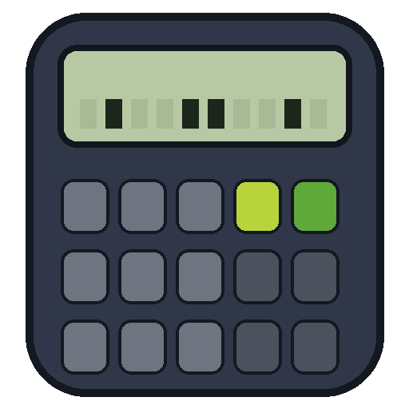

  
  <h1>Cazio</h1>
  

    A playful, skinnable scientific calculator for Windows, modelled on the classic <strong>Casio fx-991</strong> series. 
    Built with <strong>Python + PyQt6</strong>, packaged into a single <code>Cazio.exe</code>—with a hidden retro <strong>LCD arcade</strong> inside.
  

  

    
    
    
    
  

  

---

## Features

* **Scientific Engine**: `sin`, `cos`, `tan` (+ inverse & hyperbolic), `log`, `ln`, `logb`, `√`, `∛`, `ˣ√`, `x^y`, `x²`, `x³`, `x⁻¹`, `x!`, `nPr`, `nCr`, `π`, `e`, `Ans`, memory registers `A–F`, `X`, `Y`, `M` (`STO` / `RCL` / `M+`), numerical integration `∫(f,a,b)`, derivatives `d/dx(f,x)`, `CALC` for `X`, `DEG`/`RAD`/`GRA`, `S⇔D` (fractions, multiples of `π`, surds), and `ENG`. Powered by a safe, hand-written parser (no `eval`) with implicit multiplication, cursor editing, and `▲`/`▼` history.
* **Authentic Keypad & UI**: Frameless calculator window featuring gold `SHIFT` and red `ALPHA` legends, a round D-pad, and green `DEL` / `AC` keys.
* **Themes & Custom Colours**: Switch models via the gear icon, right-click, `F1`, or `MODE → THEMES`—including **Classic Slate**, **90s Atomic Purple** (translucent), **Cyberpunk Neon** (glowing keys, OLED LCD), and **Custom** hex colours for the body, buttons, and LCD backlight (saved to `config.json`). Drop any `.json` file into `themes/` to add your own preset.
* **Built-in LCD Arcade**: Launch via `MODE → ARCADE`, enter `↑ ↑ ↓ ↓ ← → ← →` on the D-pad, or type `1337=`. Includes **Snake**, **Space Invaders**, and **Flappy Pixel** (all with saved high scores), plus a **Pixel Art** sketchpad (click & drag on the LCD) and a scrolling **Marquee**.

  

---

## Quick Start

### Run from source

git clone https://github.com/<your-username>/Cazio.git
cd Cazio
py -3 -m venv .venv
.venv\Scripts\activate
pip install -r requirements.txt
python src/main.py

> Works on macOS and Linux too (`python3 src/main.py`).

### Build `Cazio.exe`

pip install -r requirements-dev.txt
pyinstaller build.spec --noconfirm --clean

Or run `build.bat` to create a virtual environment, run the test suite, and build automatically. Equivalent one-liner without the spec file:

pyinstaller --noconfirm --clean --onefile --windowed --name Cazio --icon assets\icon.ico --paths . --add-data "assets;assets" --add-data "themes;themes" src\main.py

`config.json` is saved next to `Cazio.exe` (or in `%APPDATA%\Cazio` if that directory isn't writable).

---

## Controls

| Keys | Calculator Mode | Arcade / Menus |
| :--- | :--- | :--- |
| Digits, `+ - * / ^ ( ) .` | Type expression | `2 4 6 8` = down / left / right / up, `5` = OK |
| `Enter` / `=` | Evaluate | OK |
| `Backspace` / `Esc` or `Del` | `DEL` / `AC` | `DEL` / back |
| Arrow keys | Move cursor, browse history | Move (`WASD` also supported) |
| `s` `c` `t` `l` `n` `r` | `sin` `cos` `tan` `log` `ln` `√` | — |
| `a` `p` `q` `i` `e` `E` `x` | `Ans`, `π`, `x²`, `x⁻¹`, `×10^`, `e`, `X` | — |
| `m` | `MODE` menu | Back |
| `F2` / `F3` | `SHIFT` / `ALPHA` | — |
| `F1` / `Ctrl+C` | Themes dialog / Copy result | — |

* **Pixel Art**: `0` pen mode (move/draw/erase), `1` invert, `3` save, `7` load, `DEL` clear.
* **Marquee**: Type text (or use `▲`/`▼` to cycle letters), `OK` to scroll, `▲`/`▼` to adjust speed.

---

## Project Structure

Cazio/
├── src/
│   ├── main.py               # Entry point
│   ├── calculator_engine.py  # Parser, evaluator, key state machine (Qt-free)
│   ├── ui_main.py            # Frameless window, keypad layout, shortcuts, LCD menus
│   ├── lcd.py                # LCD widget (calculator display + dot-matrix screens)
│   ├── keypad.py             # Key buttons, legends, D-pad
│   ├── themes.py             # Colour model, JSON loader, QSS builder (Qt-free)
│   ├── settings_dialog.py    # Models & custom colours dialog
│   ├── arcade_games.py       # Arcade registry & menu
│   └── config.py             # config.json persistence
├── games/                    # Pure-Python LCD screens: snake, invaders, flappy, pixel_art, menu, font
├── themes/                   # *.json model presets
├── assets/                   # Icons and README visuals
├── tests/                    # pytest suite (engine, games, themes/config)
├── tools/                    # make_icon.py, screenshot.py
├── build.spec
├── build.bat
├── requirements.txt
└── requirements-dev.txt

Arcade games render onto an `80×32` `PixelGrid` in pure Python while Qt paints the LCD dots, making them headless unit-testable (`python -m pytest`). Regenerate screenshots of every model into `docs/screenshots/` with `python tools/screenshot.py`.

---

## Disclaimer

Cazio is an independent hobby project and is not affiliated with, sponsored by, or endorsed by Casio. It uses its own name, artwork, and code; "Casio" is a trademark of its owner.

## License

MIT — see LICENSE.
